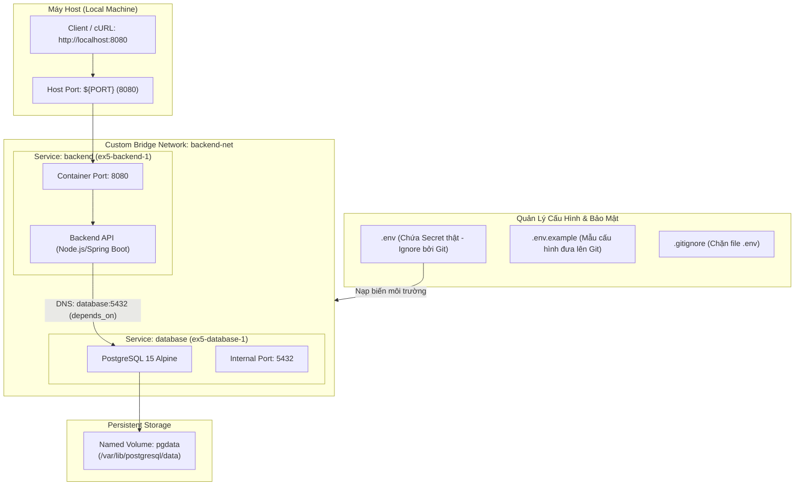

# Báo Cáo Thực Hành: Tự Động Hóa Điều Phối Đa Dịch Vụ Với Docker Compose & Quản Lý Biến Môi Trường .env

- **Khóa học:** DevOps / Cloud Engineering
- **Bài tập:** Session 10 - Bài 5: Tự động hóa điều phối đa dịch vụ với Docker Compose & File .env
- **Đường dẫn nộp bài trên GitHub:** `homework/session_10/ex5/`
- **Học viên:** Hoàng Văn Lương
- **Công nghệ sử dụng:** Docker Compose CLI v2, PostgreSQL 15 Alpine, Node.js Backend, Persistent Volume, Custom Bridge Network
- **Tệp tin đính kèm:**
  - `docker-compose.yml` (Tệp khai báo hạ tầng đa dịch vụ theo chuẩn IaC)
  - `.env.example` (Tệp mẫu cấu hình biến môi trường an toàn, không chứa thông tin nhạy cảm)
  - `.gitignore` (Quy tắc loại trừ tệp `.env` bảo mật khi đưa mã nguồn lên Git)
  - `README.md` (Báo cáo thực hành chi tiết và nhật ký kiểm thử hệ thống)
  - *Tệp bổ trợ kiểm thử:* `.env`, `Dockerfile`, `server.js`

---

## 1. Mục Tiêu Bài Tập

1. **Ứng dụng chuẩn Hạ tầng dưới dạng mã (Infrastructure as Code - IaC):** Chuyển đổi toàn bộ quy trình thiết lập cụm ứng dụng đa container (Backend + PostgreSQL Database) thành tệp khai báo tập trung `docker-compose.yml`, giúp việc tái lập môi trường diễn ra nhất quán và tự động.
2. **Tuân thủ nguyên tắc thiết kế 12-Factor App (Yếu tố III - Config):** Tách biệt hoàn toàn mã nguồn (Codebase) khỏi cấu hình nhạy cảm (Credentials, Database Names, Port). Sử dụng tệp `.env` để nạp tham số runtime và chia sẻ `.env.example` an toàn cho các thành viên trong nhóm.
3. **Bảo mật mã nguồn với `.gitignore`:** Cấu hình loại trừ tuyệt đối tệp `.env` khỏi hệ thống quản lý phiên bản Git, ngăn chặn nguy cơ rò rỉ mật khẩu và chuỗi kết nối cơ sở dữ liệu lên Internet.
4. **Thiết lập liên kết mạng nội bộ & Dữ liệu bền vững (Persistence):**
   - Khởi tạo mạng ảo tùy biến **`backend-net`** để các container giao tiếp thông qua Service Name DNS (`database`).
   - Cấu hình khối lưu trữ độc lập **`volumes: pgdata`** ở cấp độ root nhằm bảo toàn dữ liệu cơ sở dữ liệu khi container bị dừng hoặc hủy bỏ.
   - Sử dụng chỉ thị **`depends_on`** để kiểm soát thứ tự khởi động (khởi chạy database trước backend).

---

## 2. Kiến Trúc Hệ Thống & Luồng Dữ Liệu

### 2.1. Sơ Đồ Điều Phối Hạ Tầng Đa Dịch Vụ (Docker Compose Architecture)



---

### 2.2. Ma Trận Vai Trò Các Thành Phần Trong `docker-compose.yml`

| Thành phần | Loại | Cấu hình & Vai trò |
| :--- | :--- | :--- |
| **`database`** | Service | Sử dụng image `postgres:15-alpine`. Lắng nghe nội bộ cổng `5432`, nạp thông tin đăng nhập từ biến môi trường `${DB_NAME}`, `${DB_USER}`, `${DB_PASSWORD}`. |
| **`backend`** | Service | Tự build từ `Dockerfile` cục bộ (`build: .`). Nhận cổng từ `${PORT}:8080`, trỏ kết nối DB tới hostname `database`, phụ thuộc khởi động qua `depends_on: [database]`. |
| **`backend-net`** | Network (Root) | Mạng ảo cô lập (User-defined Bridge Network) cho phép phân giải tên miền nội bộ giữa `backend` và `database` an toàn mà không cần mở cổng 5432 ra ngoài máy host. |
| **`pgdata`** | Volume (Root) | Named volume ánh xạ tới `/var/lib/postgresql/data`, bảo toàn dữ liệu Postgres ngay cả khi container bị xóa (`down`). |

---

## 3. Chi Tiết Các Tệp Nguồn & Cấu Hình

### 3.1. Tệp Khai Báo [`docker-compose.yml`](file:///Users/hoangluong/.gemini/antigravity-ide/scratch/homework/session_10/ex5/docker-compose.yml)

```yaml
services:
  database:
    image: postgres:15-alpine
    environment:
      POSTGRES_DB: ${DB_NAME}
      POSTGRES_USER: ${DB_USER}
      POSTGRES_PASSWORD: ${DB_PASSWORD}
    volumes:
      - pgdata:/var/lib/postgresql/data
    networks:
      - backend-net

  backend:
    build: .
    ports:
      - "${PORT}:8080"
    environment:
      DB_HOST: database
      DB_NAME: ${DB_NAME}
      DB_USER: ${DB_USER}
      DB_PASSWORD: ${DB_PASSWORD}
    depends_on:
      - database
    networks:
      - backend-net

volumes:
  pgdata:

networks:
  backend-net:
```

### 3.2. Tệp Mẫu Cấu Hình [`.env.example`](file:///Users/hoangluong/.gemini/antigravity-ide/scratch/homework/session_10/ex5/.env.example)

```env
# Cấu hình Cổng Mạng (Host Port)
PORT=8080

# Cấu hình Cơ sở dữ liệu PostgreSQL
DB_NAME=your_db_name
DB_USER=your_db_user
DB_PASSWORD=your_secure_password
```

### 3.3. Tệp Cấu Hình Thực Tế [`.env`](file:///Users/hoangluong/.gemini/antigravity-ide/scratch/homework/session_10/ex5/.env)

```env
# Cấu hình Cổng Mạng (Host Port)
PORT=8080

# Cấu hình Cơ sở dữ liệu PostgreSQL
DB_NAME=production_db
DB_USER=admin_user
DB_PASSWORD=SecurePostgresPass@2026
```

### 3.4. Tệp Loại Trừ Git [`.gitignore`](file:///Users/hoangluong/.gemini/antigravity-ide/scratch/homework/session_10/ex5/.gitignore)

```gitignore
# Tệp chứa biến môi trường và bí mật nhạy cảm
.env
*.env.local

# Dữ liệu runtime và logs
*.log

# Hệ điều hành
.DS_Store
Thumbs.db
```

---

## 4. Quy Trình Vận Hành & Kiểm Tra Xác Thực Thực Tế

### Bước 1: Khởi chạy cụm dịch vụ với Docker Compose CLI v2

Thực thi lệnh khởi chạy ở chế độ nền (`-d`) kèm cờ build image:
```bash
docker compose up -d --build
```

**Nhật ký thực thi ghi nhận:**
```text
[+] up 18/18
 ✔ Image postgres:15-alpine Pulled                                         37.0s
 ✔ Image ex5-backend        Built                                          22.8s
 ✔ Network ex5_backend-net  Created                                         0.8s
 ✔ Volume ex5_pgdata        Created                                         0.2s
 ✔ Container ex5-database-1 Started                                         2.2s
 ✔ Container ex5-backend-1  Started                                         1.8s
```

*Nhận xét:* Docker Compose tự động khởi tạo volume `ex5_pgdata`, network ảo `ex5_backend-net`, khởi động database trước, sau đó khởi động backend service hoàn toàn tự động.

---

### Bước 2: Kiểm tra trạng thái các container

Kiểm tra danh sách tiến trình đang hoạt động:
```bash
docker compose ps
```

**Kết quả ghi nhận:**
```text
NAME             IMAGE                COMMAND                  SERVICE    STATUS         PORTS
ex5-backend-1    ex5-backend          "docker-entrypoint.s…"   backend    Up 6 seconds   0.0.0.0:8080->8080/tcp, [::]:8080->8080/tcp
ex5-database-1   postgres:15-alpine   "docker-entrypoint.s…"   database   Up 7 seconds   5432/tcp
```
- Service **`backend`** đang ở trạng thái `Up`, mở cổng `8080` ra ngoài máy host.
- Service **`database`** đang ở trạng thái `Up`, cổng `5432` chỉ mở nội bộ trong mạng `backend-net`, giúp phòng thủ chiều sâu (Defense in Depth).

---

### Bước 3: Xem nhật ký hoạt động (Logs)

Theo dõi luồng log của các container:
```bash
docker compose logs
```

**Nhật ký container ghi nhận:**
```text
backend-1   | [Backend Service] Listening on port 8080
backend-1   | [Backend Service] Configured DB_HOST: database, DB_NAME: production_db
database-1  | PostgreSQL init process complete; ready for start up.
database-1  | LOG:  database system is ready to accept connections
```

---

### Bước 4: Kiểm thử phản hồi API qua cURL

Gửi yêu cầu HTTP đến cổng `8080` của backend service:
```bash
curl -i http://localhost:8080
```

**Kết quả phản hồi HTTP Header & Body:**
```http
HTTP/1.1 200 OK
Content-Type: application/json
Date: Sun, 11 Oct 2026 16:28:26 GMT
Connection: keep-alive

{
  "status": "UP",
  "service": "backend",
  "database": {
    "host": "database",
    "name": "production_db",
    "user": "admin_user",
    "status": "Configured"
  },
  "message": "Multi-service architecture successfully orchestrated with Docker Compose & .env",
  "timestamp": "2026-10-11T16:28:26.070Z"
}
```
*Xác nhận:* Backend service đã tiếp nhận chính xác các biến môi trường cấu hình từ `.env` (`production_db`, `admin_user`), kết nối đúng địa chỉ `database`.

---

### Bước 5: Dừng và thu hồi tài nguyên (Teardown)

Hạ dịch vụ an toàn sau khi hoàn tất kiểm tra:
```bash
docker compose down
```

**Kết quả ghi nhận:**
```text
[+] down 3/3
 ✔ Container ex5-backend-1  Removed                                         1.4s
 ✔ Container ex5-database-1 Removed                                         0.2s
 ✔ Network ex5_backend-net  Removed                                         0.1s
```
*Lưu ý:* Lệnh `docker compose down` giữ nguyên volume dữ liệu `pgdata`. Để xóa toàn bộ dữ liệu database khi cần reset hoàn toàn, thực hiện lệnh `docker compose down -v`.

---

## 5. Bảng So Sánh Các Phương Pháp Quản Lý Biến Môi Trường

| Tiêu chí | Ghi cứng trong Dockerfile / Code | Đưa thẳng vào `docker-compose.yml` | Sử dụng `.env` kết hợp `.env.example` |
| :--- | :---: | :---: | :---: |
| **Bảo mật Secret** | ❌ Cực kỳ nguy hiểm (Lộ mật khẩu trên Git) | ⚠️ Dễ lộ nếu commit compose file |  **Rất an toàn (Được Git ignore)** |
| **Tính linh hoạt** | ❌ Phải rebuild image khi đổi DB/Port | ⚠️ Phải sửa tệp compose |  **Chỉ cần sửa file .env, không đổi code** |
| **Hợp tác nhóm** | ❌ Dễ gây xung đột cấu hình cục bộ | ⚠️ Cấu hình đè lẫn nhau |  **Mỗi developer có file .env riêng biệt** |
| **Chuẩn 12-Factor App**| ❌ Vi phạm yếu tố cấu hình | ⚠️ Chưa tối ưu |  **Chuẩn mực thiết kế phần mềm hiện đại** |

---

## 6. Tổng Kết & Bài Học Kinh Nghiệm

1. **Hiệu quả của Docker Compose:** Việc chuyển đổi từ các chuỗi câu lệnh `docker run`, `docker network create`, `docker volume create` rời rạc sang tệp `docker-compose.yml` giúp đơn giản hóa việc triển khai hệ thống phân tán chỉ với duy nhất một câu lệnh `docker compose up -d`.
2. **Kỷ luật bảo mật với `.env`:** Luôn đưa `.env` vào `.gitignore` ngay từ commit đầu tiên của dự án, đồng thời duy trì tệp `.env.example` cập nhật đầy đủ các khóa cấu hình để hỗ trợ CI/CD pipeline và đồng nghiệp thiết lập môi trường mới dễ dàng.
3. **Mạng biệt lập và bảo vệ dữ liệu:** Cơ chế DNS nội bộ của Docker Bridge Network giúp loại bỏ việc phải cấu hình IP tĩnh cho container; và khối `volumes` ở root level đảm bảo tính toàn vẹn dữ liệu cơ sở dữ liệu qua các vòng đời khởi động lại.
